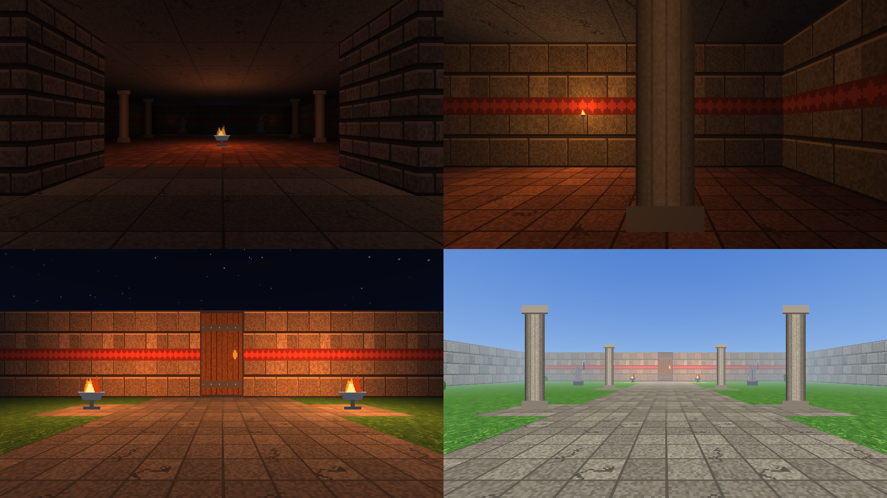

# Black Temple

A 3D engine for temple and castle dungeons, written in [CShift](https://github.com/Robert-Schneckenhaus/CShift) with
OpenGL 3.3 and GLFW. The look follows the 3D view of Ambermoon (tile based maps, textured walls, floors and ceilings,
billboard objects), the game is meant to become a mix of dungeon crawler and Zelda-style temples with puzzles.



## Features

* **Tile maps** from JSON: walls, floors and ceilings with plain **PNG textures** (any size; all wall/floor textures
  go into one texture array, sprites into another).
* **Billboards** for all objects (pillars, statues, torches, braziers ...), optionally animated, optionally blocking.
* **Point lights**, up to 32 per frame (the most relevant ones are picked), per pixel. Lights can be **animated**:
  every animation frame is a light color + intensity (+ radius). An object's light runs in sync with its sprite
  animation, so torch frame N = light frame N. Smooth interpolation between frames and random flicker are optional.
* **Distance fog** with color, start and end distance per map (`F` toggles it, `+`/`-` scales the distance).
* **Indoor** maps: own ambient light, light only from light sources (torches ...).
* **Outdoor** maps: **day/night cycle** with sky gradient, sun, moon and stars; ambient light, sun light and fog color
  follow the time of day (keyframes can be changed per map).
* **Teleport tiles** to change maps (with a fade).

## Building

Requirements: `cshiftc` (CShift 0.41 or newer, see the CShift releases) and GLFW.

```sh
# Linux
sudo apt install build-essential libglfw3-dev
cshiftc run

# Windows (PowerShell)
.\get-glfw.ps1          # downloads GLFW 3.4 -> lib\libglfw3.a
cshiftc run
```

`cshiftc build` writes `bin/black-temple`. The program looks for the `Assets` folder in the current folder or one
above it (`--assets <folder>` otherwise).

## Controls

| Key | Action |
|---|---|
| `W`/`S`, `Up`/`Down` | walk forward/back |
| `A`/`D` | strafe |
| `Q`/`E`, `Left`/`Right` | turn |
| `Shift` | run |
| right mouse button | look around |
| `T` (hold) | time runs 60x faster (outdoors) |
| `F` | fog on/off |
| `+`/`-` | fog distance |
| `Esc` | quit |

Command line: `--map <id>`, `--pos <x>,<y>[,<degrees>]`, `--hour <h>`, `--size <w>x<h>`, `--assets <folder>`,
`--screenshot <file.png> [--frames <n>]` (renders, saves a PNG and quits; useful for tests).

## Data

```
Assets/
├── Textures/*.png    wall, floor and ceiling textures (name = file name without .png)
├── Sprites/*.png     billboard sprites
├── objects.json      object types and light presets
└── Maps/*.json       maps (temple = start map, courtyard = outdoor test map)
```

The placeholder textures are generated by `tools/gen_textures.py` (Python + Pillow) and can simply be replaced by
other PNGs with the same names.

### objects.json

```jsonc
{
  "objects": {
    "torch": {
      "sprites": ["torch_0", "torch_1", "torch_2", "torch_3"],  // animation frames
      "frameTime": 0.12,       // seconds per frame
      "width": 0.18,           // world size (1 = one tile); "height" defaults to the sprite's aspect ratio
      "baseY": 0.45,           // height above the floor
      "fullbright": true,      // not affected by light (flames)
      "blocking": false, "radius": 0.25,
      "light": {
        "offsetY": 0.33, "radius": 5, "interpolate": true, "flicker": 0.06,
        "frames": [            // one light color + intensity per frame (in sync with the sprites)
          { "color": "#ffb050", "intensity": 1.7 },
          { "color": "#ff9a40", "intensity": 1.45 }
        ]
      }
    }
  },
  "lights": { "pulse_red": { "radius": 3.5, "frameTime": 0.8, "frames": [ ... ] } }  // presets for map lights
}
```

### Maps

```jsonc
{
  "name": "Black Temple - Hall of the Flame",
  "type": "indoor",                 // or "outdoor"
  "wallHeight": 1.6,
  "wallTextureRepeat": 1,           // vertical repetitions of wall textures
  "ambient": "#16121c",             // indoor ambient light
  "fog": { "color": "#000000", "start": 3, "end": 13, "useSkyColor": true },  // useSkyColor: outdoor only
  "dayNight": { "startHour": 17.5, "minutesPerSecond": 6, "keys": [ ... ] },  // outdoor only, keys optional
  "start": { "x": 11.5, "y": 12.5, "facing": "north" },
  "legend": {                       // one character per tile
    "#": { "wall": "temple_wall" },
    ".": { "floor": "temple_floor", "ceiling": "stone_ceiling" },
    "B": { "floor": "temple_floor", "ceiling": "stone_ceiling", "object": "brazier" },
    "E": { "floor": "stone_floor", "teleport": { "map": "courtyard", "x": 10.5, "y": 3.5, "facing": "south" } }
  },
  "rows": [ "#####", "#.B.#", "#.E.#", "#####" ],
  "objects": [ { "type": "torch", "x": 8.12, "y": 11.5 } ],     // free positions (e.g. torches at walls)
  "lights":  [ { "preset": "pulse_red", "x": 11.5, "y": 2.5, "height": 1.4 } ]
}
```

Positions are in tiles: `x` grows to the east, `y` to the south, `0.5` is the middle of the first tile. A space in
`rows` is solid and invisible. The day/night keyframes have `hour`, `zenith`, `horizon`, `ambient`, `fog`, `sun` and
`night` (0..1, stars); the defaults are in `src/World/daynight_default.json`.

## Source

```
src/
├── main.cshift           options, window, main loop, Game (input, map changes, fade)
├── Engine/
│   ├── Gl.cshift         loads the OpenGL functions (include/glfuncs.h)
│   ├── VectorMath.cshift Vec3, Mat4
│   ├── Camera.cshift
│   ├── Shader.cshift     GLSL programs and uniforms
│   ├── Textures.cshift   PNG folders -> texture arrays
│   └── Renderer.cshift   sky, map geometry, billboards, light selection
├── World/
│   ├── Map.cshift        map loading, tiles, objects, teleports
│   ├── Objects.cshift    object types
│   ├── Light.cshift      animated point lights
│   ├── DayNight.cshift   time of day, sky colors
│   └── JsonUtil.cshift
├── Game/Player.cshift    movement and collision
└── Shaders/              GLSL (embedded into the program)
```

## Next steps

Doors and levers, switches and pressure plates, push blocks and keys (the puzzle elements of the temples), an event
system per tile, a HUD, monsters.
